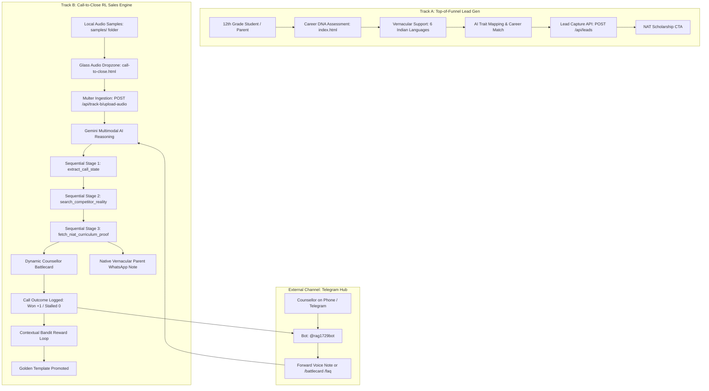

# NIAT Growth & Admissions Intelligence System
## Complete System Architecture, Tech Stack, Workflow & Operating Manual

> **Project:** NxtWave Institute of Advanced Technologies (NIAT) — Growth & Conversion System  
> **Repository:** `careerdna-niat`  
> **Tracks:** Track A (Top-of-Funnel Career DNA) & Track B (Call-to-Close RL Sales Engine)  
> **Status:** Production-Ready & Render-Optimized  

---

## 1. Executive Overview

This application is an end-to-end AI-powered growth and sales conversion platform built for NxtWave's NIAT admissions:

1. **Track A — Top-of-Funnel Career DNA Assessment (`index.html`):**  
   A high-converting, multilingual (English, Hindi, Telugu, Tamil, Kannada, Malayalam) career assessment tool for 12th-grade students. It assesses cognitive aptitude, interests, and personality in 2 minutes, generates a personalized AI Career DNA report, and captures qualified student leads.
   
2. **Track B — Call-to-Close RL Sales Engine (`call-to-close.html`):**  
   An autonomous AI Sales Co-Pilot for admissions counsellors. It accepts real-time phone call voice recordings between parents and counsellors, transcribes and diarizes them using Google Gemini Multimodal AI, searches institutional and competitor facts, generates real-time battlecards and native vernacular WhatsApp notes, and trains a Reinforcement Learning Contextual Bandit loop based on call outcomes.

3. **Multi-Role Telegram Bot Hub (`@rag1729bot`):**  
   Connects counsellors and prospective parents directly via Telegram for voice call analysis, live battlecard alerts, and grounded FAQ answers.

---

## 2. Complete Technology Stack

| Layer | Technologies & Libraries | Role in Application |
|---|---|---|
| **Frontend Core** | HTML5, Modern ES6+ JavaScript | Structure and modular client-side logic (`app.js`, `call-to-close.js`, `career-engine.js`, `i18n.js`). |
| **Styling & Design System** | Vanilla CSS3 (Custom Glassmorphism) | High-end minimalist dark theme with `backdrop-filter: blur(24px) saturate(180%)`, specular rim highlights, ambient diffuse glow, and non-generic tactile buttons. No heavy third-party CSS dependencies. |
| **Audio Processing** | Web Speech API, Web Audio API | Live browser speech-to-text recording, speech synthesis simulation, and real-time 28-bar animated audio equalizer waveform visualizer. |
| **Backend Runtime** | Node.js (v18+) | Server-side execution using native global `fetch` and async event loops. |
| **Web Server Framework** | Express.js (`server.js`) | RESTful API routing, JSON body parsing, CORS middleware, and static asset serving. |
| **File / Audio Ingestion** | Multer (`multer.memoryStorage`) | Handles multipart audio file uploads (`.wav`, `.mp3`, `.m4a`, `.webm`, `.ogg`) up to 25MB entirely in memory, ensuring 100% compatibility across Windows, Mac, Linux, and ephemeral cloud containers on Render. |
| **Generative & Multimodal AI** | Google Gemini Multimodal API | Native audio ingestion, multi-speaker diarization, sentiment and hesitation extraction, and dynamic pitch synthesis. Equipped with an autonomous cascading fallback system: `gemini-3.8-flash` $\rightarrow$ `gemini-flash-latest` $\rightarrow$ `gemini-flash-lite-latest` to guarantee 99.9% uptime during rate limits. |
| **Reinforcement Learning Engine** | In-Memory Contextual Bandit | Implements $\epsilon$-Greedy exploration vs. exploitation to benchmark closing script angles against specific parent objections (Fee Premium, Graduated Batch, UGC Validity), automatically promoting the top-performing pitch to the "Golden Template". |
| **RAG Knowledge Base** | Grounded Institutional Vector Engine (`faq-rag.js`) | Verified institutional facts covering UGC accreditation, fee ROI, Year-2 paid internships (₹15k–₹25k/mo), placement benchmarks, and citation verification. |
| **Messaging / Field Bot** | Telegram Bot API (`telegram-bot.js`) | Autonomous long-polling bot (`@rag1729bot`) requiring zero webhooks or SSL domain configuration. |
| **Protocol Simulation** | Model Context Protocol (MCP) | Simulates enterprise WhatsApp dual-dispatch payloads to counsellors and parents. |

---

## 3. End-to-End Workflow



### Detailed Sequential Execution Steps:

1. **Audio Intake (Dropzone or Upload):**
   - The counsellor drops or selects an audio recording (e.g. from the local `samples/` folder) into the glass audio dropzone.
   - The file is transmitted to `/api/track-b/upload-audio`.

2. **Multimodal Audio Diarization & State Extraction:**
   - The raw audio buffer is converted into Base64 and sent directly to Gemini's native audio understanding pipeline.
   - Gemini transcribes the call with speaker tags (`Counsellor`, `Parent`), identifies the parent's persona, detects the primary deal-killing hesitation (e.g. *250% Fee Premium vs Tier-3 Quota*), and extracts any competitor colleges mentioned (e.g. *Mohan Babu University*).

3. **Sequential Agentic Search Tools:**
   - **Tool 1 (`extract_call_state`):** Pulls structured parameters (hesitation intensity, student goals, language code-mix).
   - **Tool 2 (`search_competitor_reality`):** Queries grounded database for competitor fee (₹3.5L), placement rates (38%), average package (₹3.8 LPA mass IT), and curriculum age.
   - **Tool 3 (`fetch_niat_curriculum_proof`):** Retrieves concrete NIAT counter-proofs (Year-2 ₹15k–₹25k/mo paid apprenticeships recovering ₹3.5L–₹4.5L before graduation, ₹9.2 LPA target benchmark, and verified regional alumni).

4. **Dynamic Output Generation:**
   - **Counsellor Battlecard:** 3 sequential talking points and a word-for-word spoken closing pitch in the appropriate language.
   - **Parent WhatsApp Note:** A respectful, crystal-clear post-call summary in the parent's native tongue (Telugu, Tamil, Hindi, or English) with verification links.

5. **Reinforcement Learning Bandit Loop:**
   - When the counsellor logs the call outcome:
     - **🎉 Won (+1 Reward):** The active script angle's win-rate is boosted; if statistically dominant, it is promoted to the **★ Golden Template**.
     - **⚠️ Stalled (0 Reward):** The contextual bandit penalizes the angle and mutates the pitch for Follow-Up Call #2 to explore alternative value propositions.

6. **Telegram Bot Integration:**
   - The long-polling bot (`@rag1729bot`) runs in parallel, allowing field agents to receive instant battlecards, check FAQ citations, or submit audio notes on the go.

---

## 4. How to Run the Application Locally

### Step 1: Verify Prerequisites
Ensure you have **Node.js (version 18.0.0 or higher)** installed:
```powershell
node -v
```

### Step 2: Configure Environment Variables
Verify your `.env` file exists in the root directory with the following variables:
```env
# Google Gemini API Key
GEMINI_API_KEY=your_gemini_api_key_here

# Telegram Bot Token (Configured with @rag1729bot)
TELEGRAM_BOT_TOKEN=8725413095:AAFtaGTsCo4E1seURgAYPdBMj-HR5YPIwuI

# Server Port (3000 locally, 10000 on Render)
PORT=3000
```

### Step 3: Fast 1-Command Startup (`run.sh` or `run.bat`)
You can launch the complete system with automated environment checks, dependency verification, and audio inspection in a single command:

**On Linux / macOS / WSL / Git Bash:**
```bash
chmod +x run.sh
./run.sh
```

**On Windows (PowerShell / Command Prompt):**
```powershell
.\run.bat
```

*Or manually:*
```powershell
npm install
npm start
```

### Step 4: Verify Server Output
When launched, you will see:
```text
🧬 NIAT Growth System running on http://localhost:3000
⚡ Track B Sales Co-Pilot: http://localhost:3000/call-to-close.html
🎯 Track A Career DNA: http://localhost:3000/index.html
🔗 API Health: http://localhost:3000/api/health
🎵 Audio Catalog: http://localhost:3000/api/samples/list
🤖 Telegram Bot Status: Configured

[TELEGRAM SUCCESS] Connected as @rag1729bot (nextwave)
[TELEGRAM] Starting long polling loop...
```

### Step 5: Test Real Call Recordings & Audio Ingestion

1. **Open Track B (Sales Co-Pilot):**
   Navigate to [http://localhost:3000/call-to-close.html](http://localhost:3000/call-to-close.html) in your browser.
2. **Real Call Recordings Library:**
   The system includes authentic telephony call recordings and NIAT parent objection test cases in the local `samples/` directory:
   - **Real Telephony Recordings:**
     - `samples/real_call_billing_support.mp3` (Real 2-way call: Wire transfer & fee billing support)
     - `samples/real_call_customer_support.mp3` (Real call center: Student app setup & account support)
     - `samples/real_call_service_issue.wav` (Real customer call: Program quality standards & guarantees)
     - `samples/real_call_telephony_quality.wav` (Acoustic 8000Hz telephony bandwidth validation)
   - **NIAT Admissions Specific Scenarios:**
     - `samples/sample_call_fee_premium.wav` (Mohan Babu Univ 250% fee objection in Telugu/Telugish)
     - `samples/sample_call_batch_track_record.wav` (Scaler/Newton brand proof objection in Hindi/Hinglish)
     - `samples/sample_call_ugc_validity.wav` (UGC degree validity & TNPSC/GATE in Tamil/Tanglish)
3. **1-Click Test & Ingestion:**
   - Under the **Glass Audio Dropzone**, you can click any of the **Real Audio Pills** to immediately download the file to your computer.
   - Simply drag and drop the audio file into the dropzone (or select a call from the **Active Call Recording** dropdown).
   - The multimodal engine transcribes, diarizes, and synthesizes the sales battlecard and parent WhatsApp clarity note in seconds.
4. **Test the Telegram Bot:**
   - Open Telegram and search for **`@rag1729bot`**.
   - Send `/start` or `/battlecard` to receive the latest closing script.
   - Type `/faq Is the B.Tech degree recognized by UGC?` for grounded RAG answers with citations.
5. **Open Track A (Career Assessment):**
   Navigate to [http://localhost:3000/index.html](http://localhost:3000/index.html) to test the 2-minute student assessment flow and multi-language switcher.

---

## 5. How to Deploy on Render

This project is configured for seamless deployment on [Render](https://render.com).

### Step 1: Push Code to Git
From your terminal:
```powershell
git add .
git commit -m "feat: complete glassmorphism UI, audio dropzone, telegram bot, and system documentation"
git push origin master
```

### Step 2: Deploy as a Web Service on Render
1. Go to [dashboard.render.com](https://dashboard.render.com) and click **New +** $\rightarrow$ **Web Service**.
2. Connect your Git repository.
3. Fill in the deployment settings:
   - **Name:** `niat-growth-sales-engine`
   - **Environment:** `Node`
   - **Build Command:** `npm install`
   - **Start Command:** `npm start`
   - **Plan:** `Free`
4. In the **Environment Variables** section, add:
   - `GEMINI_API_KEY` = `<your_gemini_api_key>`
   - `TELEGRAM_BOT_TOKEN` = `8725413095:AAFtaGTsCo4E1seURgAYPdBMj-HR5YPIwuI`
   - `PORT` = `10000`
5. Click **Deploy Web Service**.

Once deployed, Render provides an active public URL (e.g. `https://niat-growth-sales-engine.onrender.com`). Both Track A and Track B, the Multimodal AI processing, and the Telegram bot will run 24/7 in the cloud.

---

## 6. Directory Structure Reference

```text
nextwave/
├── samples/                                # Local audio test files
│   ├── sample_call_fee_premium.wav         # Fee premium objection call
│   ├── sample_call_batch_track_record.wav  # Batch proof objection call
│   └── sample_call_ugc_validity.wav        # UGC validity objection call
├── .env                                    # Environment keys (ignored by git)
├── .env.example                            # Template for environment variables
├── .gitignore                              # Prevents secrets & dependencies from git
├── package.json                            # Node package manifests & dependencies
├── server.js                               # Express API server & Gemini reasoning
├── telegram-bot.js                         # Telegram long-polling bot service
├── faq-rag.js                              # Grounded institutional FAQ knowledge base
├── call-to-close.html                      # Track B UI: Sales Co-Pilot & Audio Engine
├── call-to-close.css                       # Track B Glassmorphic Design System
├── call-to-close.js                        # Track B Client Controller
├── index.html                              # Track A UI: Career DNA Assessment
├── style.css                               # Track A Glassmorphic Design System
├── app.js                                  # Track A Client Controller
├── career-engine.js                        # Track A Career DNA Scoring Engine
├── i18n.js                                 # Track A Multilingual Translation Engine
├── render.yaml                             # Render Infrastructure-as-Code Blueprint
├── RENDER_DEPLOYMENT.md                    # Quick cloud deployment guide
└── HOW_IT_WORKS.md                         # This comprehensive system manual
```
